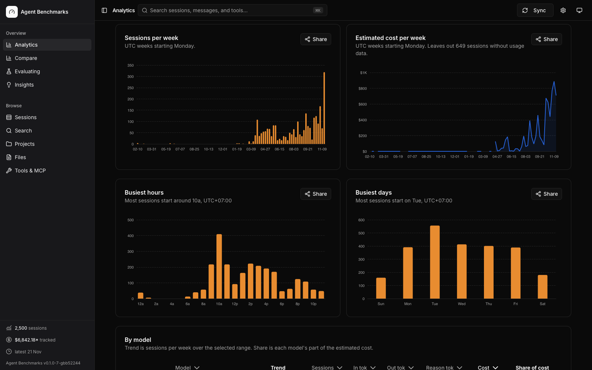
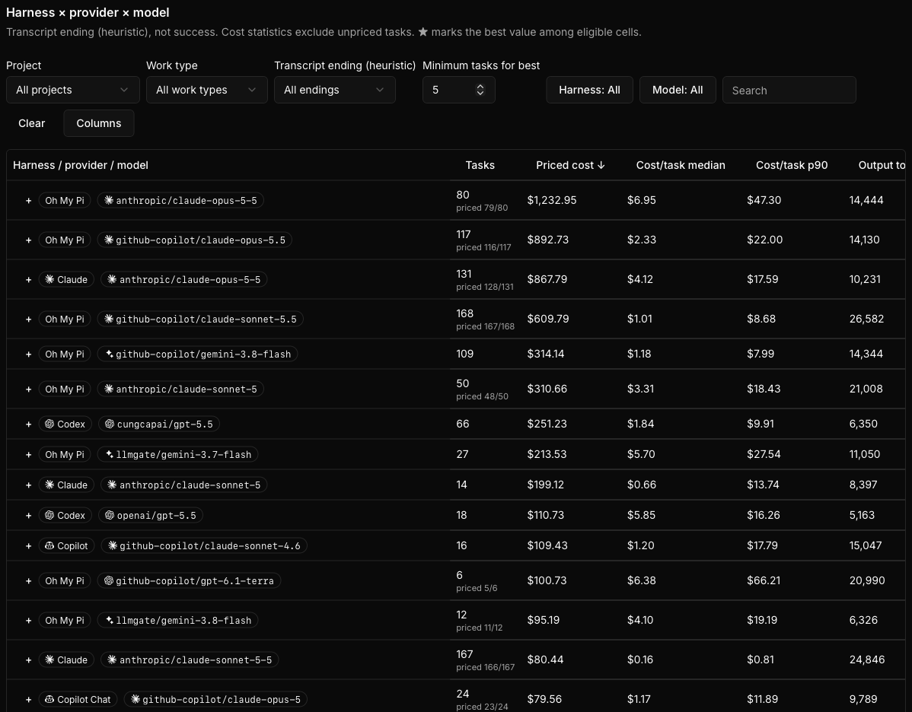
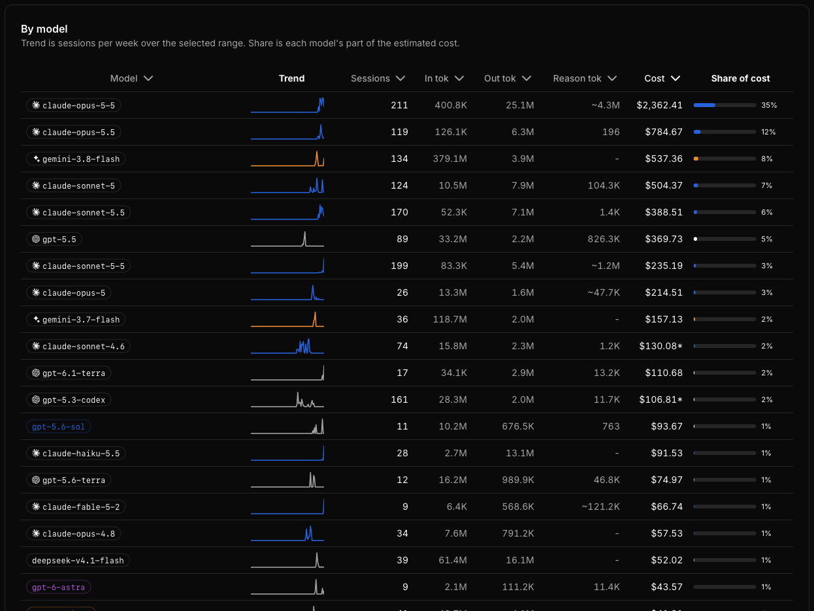
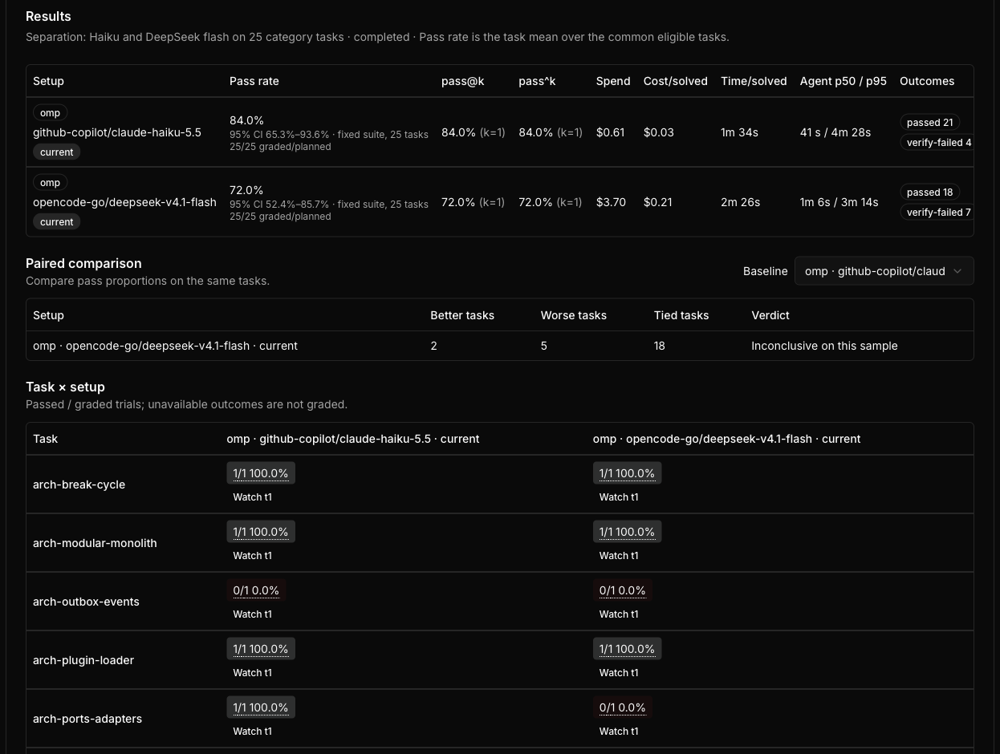
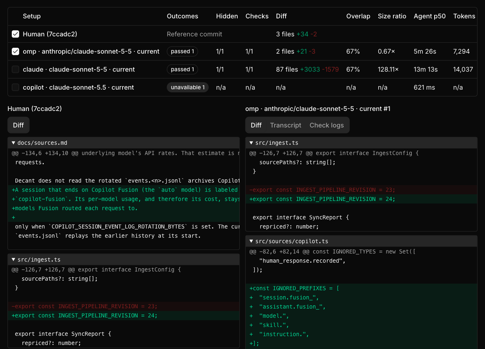
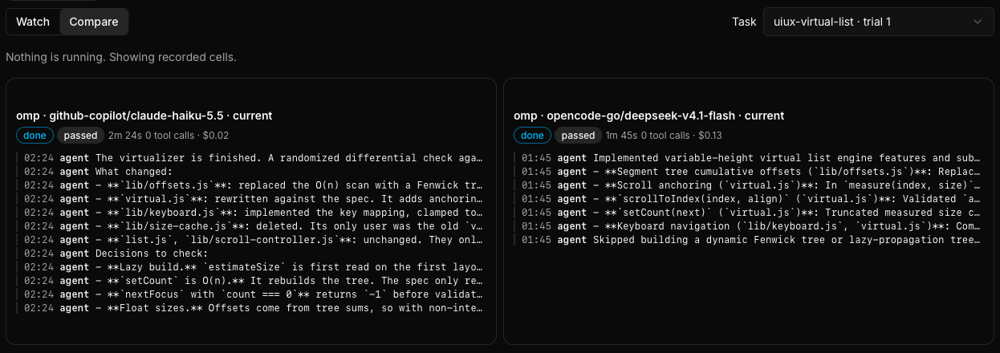

# Agent Benchmarks

[](LICENSE)

Agent Benchmarks is a private research fork for evaluating models, agent harnesses, and agentic workflows. It shows where coding agents spend tokens, money, and time. It reads the session logs that Claude Code, Codex, Gemini CLI, OpenCode, Cursor CLI, GitHub Copilot CLI, Copilot Chat in VS Code, Hermes Agent, Pi, Oh My Pi, and Factory Droid already write on your machine, plus [ATIF](https://harborframework.com/docs/agents/atif) trajectories you import, into one searchable archive.



| Compare harness × provider × model | Cost and trend by model |
| --- | --- |
|  |  |

| Benchmark results with confidence intervals | Real-task run scored against the human commit |
| --- | --- |
|  |  |



## Quick start

```sh
bun install
bun run src/cli.ts
```

This indexes the local agent logs it finds, starts the web UI at <http://127.0.0.1:3000>, and watches for new sessions. The default `bun run lens` command opens the user's existing `~/.agent-lens/lens.db` on port 4711.


## Features

- One SQLite archive for every supported agent, with full-text search across
  prompts, responses, tool names, and tool inputs.
- Session transcripts, with diagnostics for records Agent Benchmarks could not parse
  or skipped under its [input limits](docs/sources.md#input-limits).
- Token, [estimated cost](docs/pricing.md), context-window, and agent-time
  analytics by agent, model, project, repository (including worktrees), outcome,
  and day.
- File hotspots, tool usage, and MCP server usage across sessions.
- Recommendations drawn from patterns in your sessions, each with a suggested
  change you can mark as implemented.
- Session exports to Markdown, JSON, Letta's trajectory-v1, and ATIF.
- HTML reports of the analytics view or a single session. Reports leave out
  transcript messages and tool bodies but include project paths, and a session
  report adds its title, a prompt preview, and file paths. Review a report
  before you share it.
- Workflow scripts, session replays, and agent instructions (`SKILL.md`,
  `AGENTS.md` sections, and slash commands) distilled from command history.
- Real-task evaluations that run Claude Code, Codex, Copilot CLI, Oh My Pi, and
  other harnesses headless on a replayed commit or your own prompt, then score
  each against hidden tests, checks, and the human diff.
- A local HTTP API with an OpenAPI 3.1 contract, and a read-only
  [MCP server](#mcp-server) that lets coding agents query the archive.

## Supported agents

Agent Benchmarks finds each agent's logs in its default location. To point it somewhere
else, or for per-agent details, see [Sources](docs/sources.md).

| Agent | Default location | Token usage |
| --- | --- | --- |
| Claude Code | `~/.claude/projects` | Recorded |
| Codex | `~/.codex` | Recorded |
| Gemini CLI | `~/.gemini/tmp` | Recorded |
| OpenCode 1.2 and later | `~/.local/share/opencode` | Recorded |
| Cursor CLI | `~/.cursor/chats` | Not recorded by Cursor |
| GitHub Copilot CLI | `~/.copilot/session-state` | Recorded, priced at the model's API rates |
| Copilot Chat in VS Code | VS Code's `User` directory | VS Code builds from April 2026 on, as a rough estimate |
| Hermes Agent | `~/.hermes` | Recorded per session and model, not per message |
| Pi | `~/.pi/agent/sessions` | Recorded |
| Oh My Pi | `~/.omp/agent/sessions` | Recorded |
| Factory Droid | `~/.factory/sessions` | Recorded per session, not per message |
| ATIF trajectories | `~/.agent-benchmarks/atif` | From step `metrics` or `final_metrics` |

When an agent records no usage, Agent Benchmarks shows tokens and cost as unavailable
instead of $0.

## Where does my data go?

Agent Benchmarks is local-first and makes no outbound network calls at runtime. Your transcripts stay on your machine.

> [!IMPORTANT]
> Agent Benchmarks keeps a copy of your transcripts in an unencrypted SQLite archive. Prompts, tool inputs and output, raw records, source code, local paths, and credentials pasted into sessions can all be present. The archive is owner-only (`0600`); inspect, delete, or remove it when required by your retention policy. See [What the archive stores](docs/data-lifecycle.md#what-the-archive-stores).

## Installation

This fork is not published to npm, Homebrew, GitHub Releases, or a container registry. Install Bun 1.3 or newer, run `bun install --frozen-lockfile`, and use the source checkout:

```sh
bun run src/cli.ts
```

To build a local standalone binary:

```sh
bun run scripts/build-binaries.ts --target native
```

To build and run the local Docker image:

```sh
docker build -t agent-benchmarks:local .
docker run --rm -p 127.0.0.1:3000:3000 -v agent-benchmarks-data:/var/lib/agent-benchmarks agent-benchmarks:local
```

Keep the `127.0.0.1:` prefix because the local archive API is unauthenticated. Mount each source directory read-only as needed; the data-lifecycle guide documents those paths and the archive volume.

## Updating

There is no automatic release check or `update` command. Update the private checkout through its normal source-control process, then reinstall dependencies and rerun the checks below.


## Usage

### Web UI

Run `agent-benchmarks` with no arguments to sync your sessions, start the UI at
<http://127.0.0.1:3000>, and open it in your browser. `agent-benchmarks serve --no-open`
skips the browser, and `--host` and `--port` change the address.

To keep Agent Benchmarks running without a terminal, turn on **Run in the background** in
Settings or run `agent-benchmarks service install`. It then starts at login on macOS and
Linux. See [Running in the background](docs/data-lifecycle.md#running-in-the-background).

| Page | What it shows |
| --- | --- |
| Analytics | Token, cost, context, and agent-time rollups across sessions |
| Insights | Recommendations drawn from your history, the ones you have implemented, and general setup ideas not derived from your archive |
| Sessions | Sessions and their retained transcript messages |
| Search | Full-text matches in prompts, responses, tool names, and tool inputs |
| Projects | Sessions and cost for each project |
| Files | The files agents read, edit, and write most |
| Tools & MCP | Tool calls and MCP server usage |

### CLI

```sh
agent-benchmarks                         # start the local web UI
agent-benchmarks sync                    # index new and changed sessions
agent-benchmarks ls                      # list sessions
agent-benchmarks ls --repo . --since 2026-11-01  # this repository and its worktrees
agent-benchmarks ls --json --fields id,title     # only the fields you name
agent-benchmarks show 1                  # render a transcript
agent-benchmarks show 1 --outline        # list its messages and their sizes
agent-benchmarks search "auth bug"       # full-text search
agent-benchmarks project ls --limit 20   # projects with session counts and cost
agent-benchmarks stats --by model        # usage and cost rollups
agent-benchmarks economics               # token, cost, and time breakdowns
agent-benchmarks files --group ext       # file hotspots
agent-benchmarks tool stats              # tool usage
agent-benchmarks mcp stats               # MCP server usage
agent-benchmarks export 1 > session.md   # export a session
agent-benchmarks export 1 --as atif      # also md, json, and trajectory
agent-benchmarks export --mirror ~/atif  # keep a folder of ATIF documents, one per session
agent-benchmarks distill script          # workflow script from command history
agent-benchmarks db info                 # what the archive holds and where
agent-benchmarks session rm 1 --yes      # delete a session and its descendants
agent-benchmarks db vacuum               # release the freed pages after a delete
agent-benchmarks db compact              # losslessly compress stored source records
agent-benchmarks service install         # start Agent Benchmarks at login and keep it running
agent-benchmarks doctor                  # redacted environment report for bug reports
```

Run `agent-benchmarks --help` or `agent-benchmarks <command> --help` for every command and flag.
Read commands support `--json`. Global flags include `--db`, `--format`,
`--quiet`, `--no-color`, and `--no-sync`. `--db` or `AGENT_BENCHMARKS_DB` sets the
archive path. A read command does not create an archive at a path you name, so
a mistyped path is an error.

Commands exit 0 on success, 1 when the command fails, 2 on a usage error, and 3
when `sync` drops lines it cannot parse. With `--json`, an error is a JSON
object with a stable `code` on stderr. See
[CLI output, errors, and exit codes](docs/cli.md).

#### Read one session in pieces

`agent-benchmarks show <id>` prints the whole transcript, which can be megabytes for a
long session. To read part of one, list its messages first and then ask for
the ones you need:

```sh
agent-benchmarks show 1 --outline                    # one row per message
agent-benchmarks show 1 --offset 10 --limit 5        # five messages, starting at index 10
agent-benchmarks show 1 --limit 20 --max-chars 2000  # cut long text and tool output
```

| Flag | What it does |
| --- | --- |
| `--outline` | Prints one row per message with its index, role, size in characters, block kinds, and tool names. Message bodies are left out, except that each user prompt row ends with the first 80 characters of the prompt. With `--json`, the `outline` array holds up to 240 characters of each prompt. Read the whole message with `--offset <index> --limit 1`. |
| `--limit <n>` | Shows at most `n` messages. |
| `--offset <n>` | Skips the first `n` messages. The outline's `index` column is the offset of each message. |
| `--max-chars <n>` | Cuts each text, tool input, and tool output to `n` characters. |

`--limit` and `--offset` read the same page that `message_limit` and
`message_offset` return from `GET /api/sessions/{id}`, and they also page the
outline. Without any of these flags, `show` prints what it always has.

Text output ends with the range it covers, such as
`[showing 5 of 64 messages from offset 10]`, and with the command for the next
page when there is one. Each cut is marked where the content stops:
`[truncated: 3000 of 5000 chars omitted. Raise --max-chars to read more.]`.

With `--json`, the result adds `message_count`, `message_offset`,
`message_limit`, `has_more_messages`, and `partial`. `partial` is true when
messages were skipped, messages remain, or a block was cut. `--max-chars` also
adds `max_chars` and `truncated_blocks`, and each cut block carries
`truncated: true` and `original_chars`, the length of each cut field before the
cut. `--outline --json` holds the per-message rows in `messages` and the items
of `GET /api/sessions/{id}/outline` in `outline`.

`show` and `export` take Agent Benchmarks's session id or the id the source tool gave the
session, such as the Claude Code session UUID in its transcript file name. An
integer names the Agent Benchmarks id first. When one source id belongs to sessions from
two tools, the command exits 2 and lists each match with its id, tool, and
start time.

`agent-benchmarks ls` and `agent-benchmarks search` take the same scope flags:

- `--project <path>` matches one project directory. Agent Benchmarks resolves `.`, a
  relative path, `~`, a trailing slash, and a symlink before it compares.
- `--repo <value>` matches a repository, its worktrees, and any other checkout
  with the same `origin` remote. The value is a directory inside the repository
  (`--repo .` works from a worktree or a subdirectory), a remote such as
  `github.com/acme/widget`, or the name of the repository's directory. A bare
  name such as `widget` is checked against repository names first, so write
  `./widget` to mean a folder in the current directory.
- `--since` and `--until` take `YYYY-MM-DD` days in UTC. Both days are
  included, and each session counts on the UTC day it started, including a
  session whose log records a local time with an offset.
- `--limit` and `--offset` page through the rows.

A path or repository the archive has never recorded exits with code 1 and an
error on stderr, so an empty list always means the scope is known and holds no
matching session.

`agent-benchmarks ls --json` prints every field of each session. `--fields` keeps only
the fields you name, in the order you name them, on both `agent-benchmarks ls` and
`agent-benchmarks project ls`. Without `--json` they print as tab-separated columns. An
unknown field is a usage error that lists the valid names. `agent-benchmarks project ls`
prints every project unless `--limit` and `--offset` say otherwise.

### Local API

`agent-benchmarks serve` also serves a local HTTP API. Its OpenAPI 3.1 contract is
[docs/api/openapi.yaml](docs/api/openapi.yaml), and a running server exposes it
at <http://127.0.0.1:3000/api/openapi.json>. See
[API recipes](docs/api/recipes.md) for examples.

### MCP server

`agent-benchmarks mcp serve` runs a read-only [MCP](https://modelcontextprotocol.io)
server over stdio. It lets a coding agent search past sessions, list and read
transcripts, and pull usage and cost rollups from the archive. It offers four tools:
`search_sessions`, `list_sessions`, `show_session`, and `usage_stats`.

The server never syncs, because a sync can take longer than an agent waits for a
tool call. Keep the archive current with `agent-benchmarks service`, the web UI, or
`agent-benchmarks sync`.

The examples below run from a source checkout. Replace `/path/to/agent-benchmarks`
with the absolute path of the checkout. Desktop editors such as Cursor and VS Code
may not inherit your shell `PATH`, so use the absolute path from `which bun` there.
With a standalone binary, use the binary as the command and `mcp serve` as the
arguments. To read an archive other than the default, add the environment variable
`AGENT_BENCHMARKS_DB=/path/to/archive.db`.

Claude Code:

```sh
claude mcp add --scope user agent-benchmarks -- bun /path/to/agent-benchmarks/src/cli.ts mcp serve
```

Codex:

```sh
codex mcp add agent-benchmarks -- bun /path/to/agent-benchmarks/src/cli.ts mcp serve
```

GitHub Copilot CLI:

```sh
copilot mcp add agent-benchmarks -- bun /path/to/agent-benchmarks/src/cli.ts mcp serve
```

OpenCode:

```sh
opencode mcp add --global agent-benchmarks -- bun /path/to/agent-benchmarks/src/cli.ts mcp serve
```

Cursor reads `~/.cursor/mcp.json`, and Gemini CLI reads `~/.gemini/settings.json`.
Both take the same block:

```json
{
  "mcpServers": {
    "agent-benchmarks": {
      "command": "bun",
      "args": ["/path/to/agent-benchmarks/src/cli.ts", "mcp", "serve"]
    }
  }
}
```

VS Code with Copilot Chat:

```sh
code --add-mcp '{"name":"agent-benchmarks","command":"bun","args":["/path/to/agent-benchmarks/src/cli.ts","mcp","serve"]}'
```

Then ask the agent something like "which sessions last week touched the auth
middleware, and what did they cost?". See [docs/cli.md](docs/cli.md#mcp-server)
for each tool's arguments.

## Documentation

Using Agent Benchmarks:

- [CLI output, errors, and exit codes](docs/cli.md)
- [Sources and where Agent Benchmarks finds them](docs/sources.md)
- [How the analytics are calculated](docs/analytics-methodology.md)
- [Pricing estimates and their sources](docs/pricing.md)
- [What the archive stores, and how sync and deletion work](docs/data-lifecycle.md)
- [Local API routes](docs/api/routes.md) and [recipes](docs/api/recipes.md)
- [Operational logging](docs/logging.md)

Working on Agent Benchmarks:

- [Contributing guide](CONTRIBUTING.md)
- [Architecture](docs/architecture.md)
- [Adding a source](docs/adding-a-source.md)
- [Guidance for coding agents](AGENTS.md)

## Development

This is a private research fork. Work against the local checkout and keep tests and fixtures synthetic.

```sh
bun install --frozen-lockfile
bun test
bunx tsc --noEmit
bunx biome check .
```

See [CONTRIBUTING.md](CONTRIBUTING.md), [AGENTS.md](AGENTS.md), and [SECURITY.md](SECURITY.md) for local conventions and privacy requirements.


## Acknowledgments

Agent Benchmarks was inspired in part by
[Letta's Trajectory](https://github.com/letta-ai/trajectory), which normalizes
agent transcripts across runtimes into a shared record format.

## License

Agent Benchmarks is licensed under the [Apache License 2.0](LICENSE).
